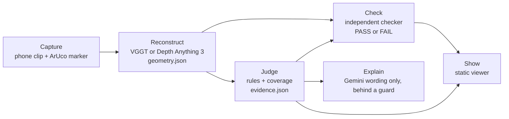

# Virtual Safety Inspection

**Team Hallucinati** (Shriya, Kaushal, Nadeem), for the Google Cloud AI Builder Cup 2026.

A phone clip of a room becomes a safety verdict (blocked exit, door clear width) with an evidence file. A separate checker recomputes every claim from the stored geometry and prints PASS or FAIL. When a view is missing, the system says **not proven** and asks for that exact view instead of guessing. Gemini explains the verdicts in plain words and can never change them.

**Live demo:** https://virtual-safety-hallucinati.web.app/ (Firebase Hosting, free plan; Gemini through Firebase AI Logic).
**Submission text:** `docs/SUBMISSION.md`. **How it works:** `docs/how-it-works.md`.



## What is real and what is not
Everything runs on three SYNTHETIC rooms rendered by `tools/synthetic_room` (clear exit, blocked exit, a floor that was never filmed). No real room has been shown: a real phone clip rebuilt in 3D with a measured scale, tape-measured ground truth and final thresholds are future work. Every number here (for example 1.0 m, 0.70 m, 0.86 m) comes from a render, and the rule parameters in `samples/handmade/placeholders*.json` are placeholders. Checker PASS means the claims were re-verified, not that a room is safe.

| Part | State |
| --- | --- |
| Schemas (`schema/`) | v0.1, samples validate |
| Reconstruction (`reconstruct/`) | `run.py` ran on the three synthetic clips with VGGT on a free GPU (`docs/spike-report.md`); not run on a real clip |
| Rules (`rules/`) | blocked exit, door width, coverage, evidence writer; correct on the synthetic truth geometry (`docs/rules-run.md`) |
| Checker (`checker/`) | independent re-verification; PASS on correct evidence, FAIL on wrong evidence (`tests/synthetic_checker.py`) |
| End to end (`tests/e2e.py`) | geometry to rules to checker on all three clips against ground truth: ALL AS EXPECTED (`docs/e2e-run.md`) |
| Viewer (`viewer/`) | static page with plan, frames, checker result, not-proven request and Q&A; browser copy of the explanation guard in `viewer/vs-guard.js` |
| Google adapter (`adapters/google/`) | answers from `evidence.json`; Gemini may only reword behind the guard |

## Try it
Standard library only, from the repository root:
```sh
python3 schema/validate.py --all          # every sample against the schemas
python3 tests/e2e.py                      # rules and checker on all three clips vs ground truth
python3 tests/synthetic_checker.py        # checker passes correct evidence, fails wrong evidence
python3 tests/test_explanation_guard.py   # hostile model output cannot change a verdict
python3 -m http.server                    # then open http://localhost:8000/viewer/?clip=clip2_blocked
```
Make the synthetic clips yourself: `tools/synthetic_room/README.md` (needs `numpy` and `opencv-python`). Run the reconstruction on a GPU: `docs/install-notes.md`. Publish the viewer: `docs/firebase-deploy.md`.

## Notes
- Task numbers (T8) and decision numbers (D8) in the docs are the team's internal labels; `docs/decisions.md` lists the decisions the code depends on.
- The repository contains no model weights, no clips and no keys. VGGT and Depth Anything 3 are installed from their own repositories; their weight licences are noted in `docs/install-notes.md`.
- Licence: MIT (`LICENSE`).
